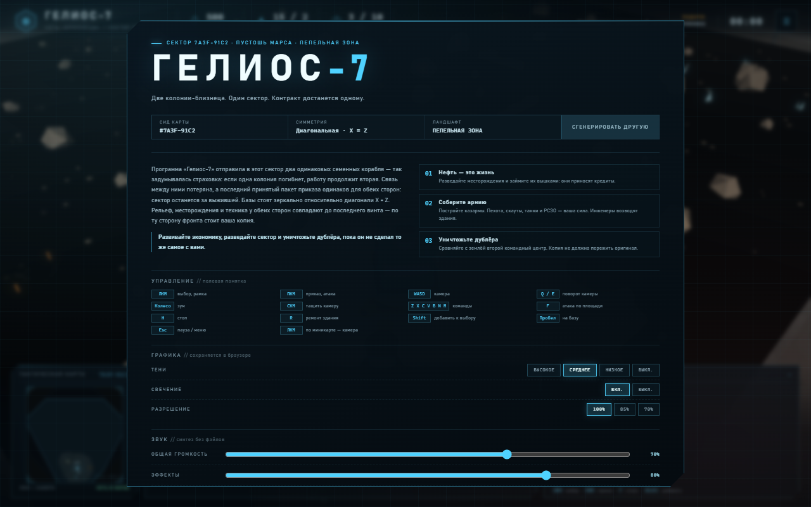
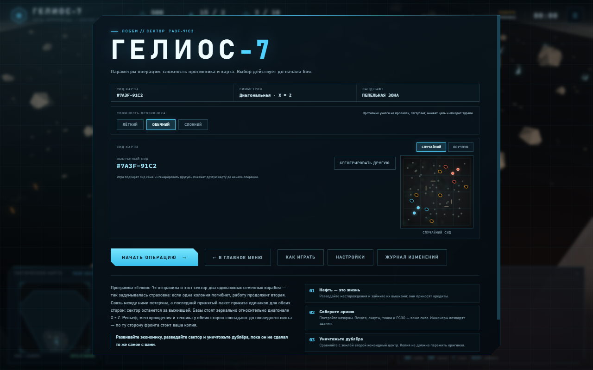
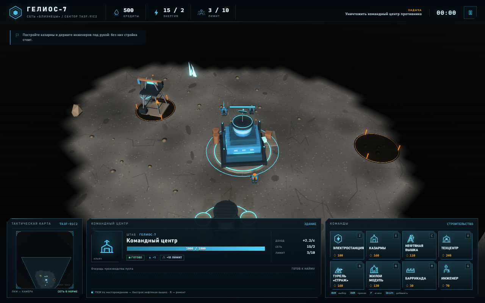
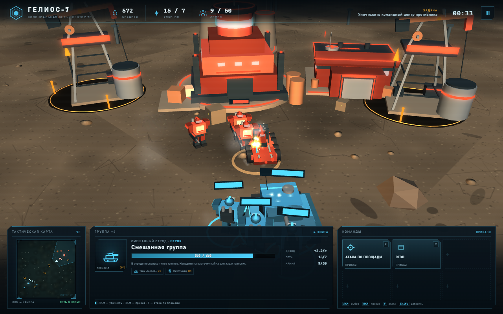
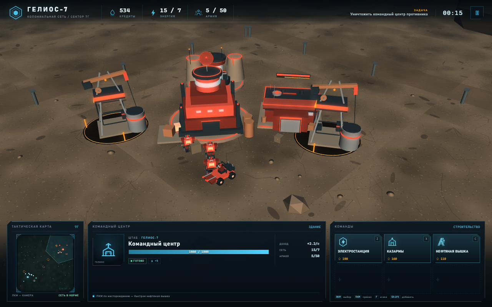

# ГЕЛИОС-7

Маленькая 3D-стратегия в реальном времени в духе StarCraft на **Babylon.js**.
Вся графика — примитивы, сгенерированные процедурно: ни одной внешней модели,
текстуры или звука. Только HTML, CSS, JavaScript и Babylon.js. Карты тоже
генерируются процедурно: симметричные, с бесконечным числом вариантов.
Игра работает и на телефоне: интерфейс перестраивается под вертикальный и
горизонтальный экран, а камера и приказы управляются касаниями.


## Играть онлайн

Открыть в браузере: <https://dement0r.github.io/babylonjs-rts-game/>.

Устанавливать ничего не нужно: это статическая страница на GitHub Pages.
Она обновляется автоматически workflow
[`deploy-pages.yml`](.github/workflows/deploy-pages.yml) после каждого пуша
в `main` или `master`. Если репозиторий ещё не опубликован, см. раздел
[«Публикация на GitHub Pages»](#публикация-на-github-pages).

## Запуск

Нужен только **Node.js 18+**. Никаких зависимостей и сборки.

```bash
npm start
```

или

```bash
node server.mjs
```

Откройте <http://127.0.0.1:5173>.

> Открыть `index.html` двойным щелчком нельзя: браузер блокирует ES-модули
> на `file://`. Используйте локальный сервер.

## Карты и сиды

Карта полностью определяется 32-битным сидом. В главном меню откройте
**«Лобби»**: там собраны параметры матча — сложность противника, туман войны и
способ выбора сида, случайный (по умолчанию) или ручной. Туман по умолчанию
включён; выключенный открывает обеим сторонам всю карту. В ручном режиме
введите до восьми hex-символов (например, `7A3F91C2`) или любое слово — лобби
сразу покажет мини-карту, симметрию и ландшафт будущего сектора. Кнопка
**«Сгенерировать другую»** подбирает новый случайный сид.

В главном меню есть три режима. **«Кампания»** — пять сюжетных операций с
брифингами, целями и постепенным открытием техники: победа открывает
следующую миссию. **«Испытания»** — шесть фиксированных сценариев без сюжета
(уничтожить КП, продержаться, захватить месторождения) с сохранением лучшего
времени. **«Лобби»** — свободная партия на любом сиде.



Без параметра в адресе игра выбирает случайный сид и записывает его в строку
браузера, поэтому обновление страницы оставляет ту же карту. Ссылкой можно
поделиться:

```
http://127.0.0.1:5173/?seed=7A3F91C2
```

Кнопки **«Новая карта»** (пауза и итоги) генерируют новый сид, а
**«Повторить эту карту»** перезапускает текущую. В генераторе пять типов
симметрии:

- центральная (поворот на 180°);
- зеркальная относительно оси X;
- зеркальная относительно оси Z;
- диагональная (`X = Z`);
- диагональная (`X = −Z`).

Ландшафт выбирается из четырёх палитр: ржавая пустошь, базальтовые поля,
охристые дюны и пепельная зона. Позиции баз, месторождений, камней, ящиков,
кристаллов и руин стен строятся парами, поэтому карта честная для обоих
игроков.
Игровое поле — квадрат ±110 единиц. Генератор масштабирует вместе с картой
декор и расстояния, но компоновка баз упирается в потолок масштаба: на большом
поле между стартовыми позициями остаётся больше свободного места для манёвра.

Проверить генератор на тысяче сидов можно без браузера:

```bash
npm run verify:maps
```

Скрипт проверяет детерминизм, симметрию всех объектов, корректность стартовых
баз и разнообразие карт.

## Что происходит

Вы командуете колонией «Гелиос-7» на пустоши Марса. Программа колонизации
отправила в этот сектор два одинаковых семенных корабля: если одна колония
погибнет, работу продолжит вторая. Связь между ними потеряна, а последний
приказ одинаков для обеих сторон — сектор останется за выжившей. По ту
сторону фронта стоит ваша копия: та же техника, те же чертежи, те же
инженеры. Нужно развить экономику, разведать сектор и уничтожить второй
командный центр, пока дублёр не сделал то же самое с вами.

Симметрия карты — не условность, а часть сюжета: обе стороны играют одними
и теми же юнитами и зданиями, поэтому карта честная по построению.

Каждый запуск строит новую карту из случайного сида. Карта симметрична:
базы, месторождения, камни, ящики и кристаллы отражаются относительно центра
или оси, поэтому рельеф и ресурсы честно поделены между двумя одинаковыми
колониями.
Понравившуюся карту можно сохранить ссылкой — она воспроизводится из сида
один в один.



## Возможности

- **Туман войны и разведка.** Карта открывается по мере продвижения:
  вокруг своих юнитов и зданий видно всё, а неисследованные области скрыты —
  вместе с противником, месторождениями и обломками. Уже пройденные места
  остаются приглушёнными на карте и на тактической карте. Разведанные
  постройки противника запоминаются: в серой зоне виден их приглушённый
  силуэт, но не прочность, очередь и не идущее внутри производство. Живые
  юниты по-прежнему скрыты, а новая постройка в серой зоне не появится,
  пока её не увидят. Противник помнит разведанные здания по тем же правилам,
  поэтому скауты и разведка боем остаются полезными.
- **Главное меню и три режима** — «Кампания», «Испытания» и «Лобби».
  Кампания состоит из пяти операций на фиксированных сидах: у каждой свой
  брифинг, набор доступных построек и войск, цели и настройки противника.
  Победа открывает следующую операцию и новую технику, прогресс хранится в
  браузере. Испытания — шесть отдельных сценариев без сюжета: сложный темп,
  ограничения на технику, рекорды времени. В лобби выбираются сложность
  противника, туман войны и сид карты: случайный (по умолчанию) или ручной, с
  живым предпросмотром — мини-карта, симметрия и ландшафт. Ручной сид вводится
  hex-кодом или обычным словом.
- **Бесконечные симметричные карты** — 5 типов симметрии и 4 палитры
  ландшафта. Сид карты виден в интерфейсе и хранится в адресе (`?seed=...`).
  Поле боя — ±110 единиц.
- **Командный центр** — строительство, наём инженеров, базовая энергия,
  точка обороны и 10 единиц лимита армии.
- **Электростанции** — дают +10 энергии. При дефиците производство замедляется втрое.
- **Жилой модуль** — расширяет лимит армии на 10 единиц и потребляет 3 энергии.
  Без модулей тяжёлая техника быстро упирается в потолок отряда.
- **Турель «Страж»** — стационарное орудие: сама выбирает наземные цели в
  радиусе 17 и ведёт огонь без команд игрока.
- **Баррикада** — дешёвый сегмент стены, который перекрывает путь наземным
  юнитам. Из баррикад можно собрать линию обороны или узкий проход.
- **Казармы** — наём пехоты, скаутов, танков и РСЗО.
- **Техцентр** — два раздела исследований. «Войска»: пехота, скауты, танки и
  РСЗО (по два уровня), медики и инженеры. «База»: турели, укрепления,
  эффективность добычи, аварийный ремонт, логистика и резерв лимита армии.
  Каждое исследование действует на всех юнитов или зданий своего типа — и на
  уже построенные, и на будущие. Исследования — долгая инвестиция: каждое
  стоит заметно дороже юнита и идёт десятки секунд.
- **Нефтяные вышки** — ставятся на месторождения и приносят 2.2 кредита в секунду.
- **Шесть типов юнитов** (в скобках — сколько лимита армии занимает юнит):
  - **Инженер** (1) — строит здания и ремонтирует повреждённую технику рядом;
    чем больше инженеров на стройке, тем быстрее;
  - **Пехотинец** (1) — дешёвый универсальный стрелок;
  - **Медик** (1) — безоружный санитар: сам лечит раненую пехоту рядом;
  - **Скаут** (2) — быстрый рейдер;
  - **Танк «Молот»** (4) — тяжёлая машина с площадным уроном;
  - **РСЗО «Гроза»** (5) — хрупкая и дорогая установка: залп из пяти ракет
    накрывает площадь с дистанции 34, но требует прикрытия и бьёт по своим
    юнитам, зданиям и самой установке, если они оказались в зоне поражения.
- **Экономика и энергосеть**: доход, стоимость, очередь производства, дефицит мощности.
- **Строительство** с голографическим превью, проверкой места и прогрессом.
  Здание возводится только рядом с инженерами; каждый помощник ускоряет
  стройку (до четырёх), без инженеров прогресс замирает. Баррикады и турели
  позволяют превратить базу в укрепрайон.
- **Лимит армии**: командный центр даёт 10 единиц, каждый жилой модуль — ещё
  10. Занятый лимит виден в шапке, подсказках и карточке выбранного юнита.
- **Ремонт** повреждённых зданий за кредиты: команда `R` включает постепенное
  восстановление и списывает деньги только за реально полученные HP. Полный
  ремонт стоит около 85% цены постройки, так что дешевле не подставлять здания
  под удар.
- **Полевые медики**: медик сам находит раненую пехоту рядом и постепенно
  восстанавливает ей HP. Он безоружен, поэтому его нужно прикрывать.
- **Полевой ремонт техники**: инженер чинит повреждённые танки, скауты и РСЗО
  рядом с собой. Пока идёт ремонт, он не отвлекается на случайные цели, но
  отвечает на огонь в упор.
- **Видимые снаряды**: пули, танковые снаряды с дымным следом и ракеты РСЗО
  летят по-настоящему, а урон наносится в момент попадания.
- **Огонь по своим у РСЗО.** Залп «Грозы» не разбирает, где свои, а где
  чужие: юниты, здания и сама установка в зоне поражения получают полный
  урон. Стрелять по врагу, который сцепился с вашими войсками или стоит
  у вашей базы, теперь опасно для своих.
- **Гильзы по калибру оружия**: винтовка пехотинца выбрасывает мелкие гильзы,
  скаут — крупнее, а танковая пушка и турель — тяжёлые, которые дольше летят и
  катятся по земле.
- **Управление армией**: рамка выделения, Shift-добавление, формации,
  attack-move, автоатака, точка сбора, остановка и «держать позицию».
  Отданный приказ на перемещение выполняется даже под огнём: отряд не
  разворачивается в бой самовольно.
- **Поиск пути по навигационной сетке**: юниты обходят здания, камни, ящики
  и руины стен, перестраивают маршрут при смещении цели и не застревают на
  углах построек.
- **Противник** с собственной экономикой, гарнизоном, нарастающими волнами и
  застройкой базы: ИИ разведывает карту, занимает месторождения не только
  рядом с базой противника, но и в центре и на вашей половине, нанимает инженеров, строит
  электростанции, казармы, турели и техцентр, расширяет лимит армии жилыми
  модулями, исследует улучшения, защищает своих инженеров и ремонтирует
  повреждённые здания. Тактика волн меняется: полномасштабный штурм, рейд по
  экономике, удар с двух направлений или разведка боем. Если разведка
  показывает, что наши войска заметно сильнее его армии, противник не
  отправляет волну на верную гибель, а держит оборону и копит силы.
- **Победа/поражение**, статистика операции, пауза, рестарт.
- **Настройки** — отдельный экран с вкладками «Графика» и «Звук», доступный
  со стартового экрана и из паузы: качество теней, свечение, разрешение
  рендера, общая громкость, эффекты и окружение. Выбор сохраняется в браузере.
- **Памятка по управлению** — отдельный экран «Как играть» со всеми горячими
  клавишами и подсказками для сенсорных экранов.
- **Интерфейс**: командная панель с хоткеями и подсказками, тактическая карта,
  поворачивающаяся вместе с камерой, очереди, полоски здоровья, лента событий.
- **Мобильная версия**: адаптивная шапка и нижняя панель для телефонов и
  планшетов, включая вертикальную ориентацию. Тап выбирает и отдаёт приказы,
  двойной тап выделяет всех юнитов этого типа на экране, один палец двигает
  карту, два пальца растягивают рамку выбора, а щипок меняет зум. Экранные
  кнопки дублируют камеру, зум и отмену режима строительства. Сохранённые
  отряды видны иконками у правого края: нажатие выделяет отряд, двойное —
  наводит камеру.
- **Журнал изменений в игре**: кнопка «Журнал изменений» на стартовом экране,
  в паузе и на экране итогов. Сборки сгруппированы по датам из истории git,
  а записи берутся из `CHANGELOG.md`.

## Управление

| Действие | Клавиша / мышь |
| --- | --- |
| Выбрать | ЛКМ |
| Выбрать группу | ЛКМ + рамка |
| Добавить к выбору | Shift + ЛКМ |
| Запомнить отряд | `Shift` + `1`…`9` |
| Вызвать отряд | `1`…`9` (двойное нажатие — камера к отряду) |
| Приказ / атака | ПКМ |
| Атака по площади | `F`, затем ЛКМ |
| Остановить | `H` |
| Держать позицию | `P` |
| Быстрые команды | `Z`, `X`, `C`, `V`, `B`, `N`, `M` (и `G` — инженер) |
| Заказать сразу 5 юнитов | Shift + клик по иконке найма |
| Ремонт здания | `R` |
| Камера | `WASD` / стрелки, зажать СКМ и тянуть |
| Поворот камеры | `Q` / `E` |
| Зум | колесо мыши |
| Вернуться на базу | `Пробел` |
| Пауза / меню | `Esc` |
| Миникарта | ЛКМ — переместить камеру |
| Тап по сцене (телефон) | выбрать объект, отдать приказ или разместить здание |
| Двойной тап по юниту (телефон) | выделить всех юнитов этого типа на экране |
| Один палец | панорама камеры |
| Два пальца | рамка выбора юнитов; щипок — зум |
| Экранные кнопки | камера, зум, поворот, «База», снятие выделения и «Отмена» |

## Советы

1. Сначала постройте казармы и займите свободное месторождение.
2. Держите энергосеть в плюсе: дефицит режет скорость производства.
3. Следите за лимитом армии: командный центр даёт только 10 единиц, поэтому
   перед танками и РСЗО постройте жилой модуль.
4. Инженер — самый ценный юнит на стройке. Нанимайте второго в командном
   центре и не отправляйте их в бой.
5. Техцентр — долгая инвестиция: исследование дорого и идёт десятки секунд,
   зато усиливает сразу весь отряд этого типа, включая уже построенных.
6. Не оставляйте базу без гарнизона — противник приходит волнами и сам
   застраивает сектор. Турель у прохода и пара баррикад заметно повышают
   шансы удержать базу.
7. Танк хорошо разбирает скопления пехоты, но медленный. Скауты быстро
   добивают вышки и отступающих. РСЗО накрывает площадь с дистанции 34, но
   она дорогая и очень хрупкая — держите её за спинами пехоты и не бейте
   по врагу рядом со своими войсками или зданиями: залп заденет и их.
8. Уничтожение вышек противника заметно замедляет его экономику.





## Структура

```
.github/
  workflows/
    deploy-pages.yml публикация на GitHub Pages
.nojekyll           отключает обработку Jekyll на Pages
index.html          разметка HUD
styles.css          оформление интерфейса
favicon.svg         иконка
server.mjs          статический сервер без зависимостей
scripts/
  verify-maps.mjs   проверка генератора карт на выборке сидов
  build-changelog.mjs сборка игрового журнала изменений из CHANGELOG.md
src/
  main.js           движок, сцена, камера, игровой цикл
  config.js         баланс, характеристики, параметры карты
  mapgen.js         процедурные симметричные карты и сиды
  nav.js            навигационная сетка и поиск пути A* (чистый JS)
  fog.js            туман войны: видимость, разведка и затемнение карты
  models.js         все модели из примитивов + батчинг
  world.js          земля, небо, свет, декор, месторождения
  effects.js        трассеры, взрывы, дым, снаряды, маркеры
  entities.js       юниты и здания, движение, бой, производство
  game.js           состояние, экономика, приказы, победа
  ai.js             противник и волны
  input.js          камера, выбор, приказы, строительство
  audio.js          синтез выстрелов, взрывов и интерфейса через Web Audio
  radio.js          формантный синтез ответов на приказы
  ambient.js        фоновые звуковые ландшафты для палитр карт
  settings.js       настройки графики, звука, сложности ИИ и тумана войны
  ui.js             HUD, миникарта, оверлеи, подсказки, мобильная раскладка
  icons.js          SVG-иконки
  changelog.js      данные журнала изменений для экрана в игре
vendor/
  babylon.js        Babylon.js 8.56.2 (UMD, Apache-2.0)
  LICENSE-babylon.md
docs/
  ai-plan.md        план развития противника и сложности ИИ
  bugs-plan.md      перечень багов и принятых решений
  teams-plan.md     план партий с несколькими ИИ и командами
screenshots/        скриншоты для README
```

## Технические заметки

- Babylon.js подключён готовым UMD-бандлом (`vendor/babylon.js`), поэтому
  сборка не нужна. Версия — 8.56.2, лицензия Apache-2.0.
- Статичные части моделей склеиваются по материалам, декор переведён на
  инстансы, а bloom исключён для юнитов и интерфейсных элементов — это
  заметно снижает число draw call'ов при больших армиях.
- Все текстуры (земля, небо, спрайты эффектов) генерируются в `DynamicTexture`.
- Генератор карт (`mapgen.js`) — чистый JavaScript без Babylon.js: его можно
  проверять и переиспользовать в Node. Один и тот же сид всегда даёт одну и ту
  же карту, включая позиции баз, месторождений и руин стен.
- `nav.js` тоже не зависит от Babylon.js: сетка 2×2 единицы, A* с диагоналями
  и сглаживанием пути. Пересобирается при постройке или сносе здания, поэтому
  новые стены сразу становятся препятствиями. `verify:maps` отдельно
  проверяет, что сгенерированные стены не отрезают базы друг от друга.
- Туман войны (`fog.js`) считается по сетке 3×3 единицы: каждый юнит и
  здание «подсвечивает» клетки вокруг себя, а туман рисуется одной
  полупрозрачной плоскостью над землёй. Неисследованные области скрывают
  и противника, и декор, а наведение запрещает стрелять по невидимым целям.
  Разведанные постройки противника хранятся отдельно от клеток и рисуются
  приглушёнными силуэтами, пока их снова не увидят.
- Сенсорный режим включается по `pointer: coarse`/`maxTouchPoints`. Тап
  выбирает и отдаёт приказы, один палец панорамирует камеру, два пальца
  растягивают рамку выделения, а щипок меняет зум. Прицел считается в
  CSS-пикселях холста, поэтому касание совпадает с картой при любом
  разрешении рендера.
- Настройки графики и звука хранятся в `localStorage`
  (`gelios.graphics.v1`, `gelios.audio.v1`), сложность ИИ — в
  `gelios.difficulty.v1`, туман войны — в `gelios.fog.v1`, прогресс кампании и
  рекорды испытаний — в `gelios7.missions.v1`. Графика и звук
  применяются сразу, сложность и туман — при старте партии. Режим сида
  хранится в адресе (`?seedmode=manual`), а ручной сид применяется
  перезагрузкой с `?seed=...&start=1`.
- Звук тоже генерируется: `audio.js` рендерит буферы выстрелов, попаданий и
  взрывов в `OfflineAudioContext` при загрузке страницы, `radio.js` собирает
  неразборчивые ответы на приказы формантным синтезом, а `ambient.js`
  собирает фон из розового шума и редких синтезированных событий — в проекте
  по-прежнему нет ни одного звукового файла. `AudioContext` создаётся только
  после первого жеста пользователя (политика автозапуска браузеров), а
  громкость и панорама выстрелов считаются от камеры. В перестрелке работает
  бюджет голосов, чтобы десятки одновременных выстрелов не превращались в
  шум; настройки звука хранятся в `gelios.audio.v1`.
- Игровой журнал (`src/changelog.js`) не пишется вручную: его собирает
  `npm run changelog:build` из `CHANGELOG.md`, подставляя даты коммитов,
  которые добавили запись. Поэтому в игре видны настоящие даты сборок.
- Отладочные функции доступны по адресу `/?debug` (объект `window.__GAME__`,
  текущая карта — `window.__MAP__`). С `?debug=ai` включается панель ИИ с
  вкладками «Разведка», «Волны» и «Экономика». «Разведка» показывает, что
  противник успел узнать о наших войсках и как он оценивает соотношение сил,
  «Волны» — статистику атак, «Экономика» — кредиты, энергию, лимит армии и
  план стройки.
- Проверено в Chrome/Edge с WebGL2, включая эмуляцию мобильных экранов.
  Нужен браузер с поддержкой WebGL2 и Pointer Events.

## Публикация на GitHub Pages

Игра — статический сайт, поэтому на runner'е не нужны Node.js, npm и сборка:
workflow копирует в `_site` только `index.html`, `styles.css`, `favicon.svg`,
`src/` и `vendor/`, а затем публикует артефакт через `actions/deploy-pages`.
Запускается он при пуше в `main`/`master` и вручную из вкладки **Actions**
(`workflow_dispatch`).

Первая публикация:

1. Создайте на GitHub пустой репозиторий и добавьте remote (если его ещё нет):

   ```bash
   git remote add origin https://github.com/DEMENT0R/babylonjs-rts-game.git
   git push -u origin HEAD
   ```

2. В репозитории откройте **Settings → Pages → Build and deployment** и
   выберите **Source: GitHub Actions**.

3. Запустите workflow **Deploy to GitHub Pages** на вкладке **Actions** или
   сделайте новый пуш. После завершения игра будет доступна по адресу
   `https://<аккаунт>.github.io/<репозиторий>/`.

> Если первый запуск прошёл до включения Pages, он завершится ошибкой.
> Откройте его и нажмите **Re-run all jobs**.

Все ссылки в `index.html` и импорты в `src/` относительные, поэтому сайт
работает и в корне домена, и в подкаталоге проекта, и с кастомным доменом.

## Ограничения

Игра намеренно небольшая: нет многопользовательского режима и
полноценной физики. Поиск пути — сеточный A* без учёта юнитов как препятствий
(толпа разбирается локальным расталкиванием). Это скорее аккуратный прототип
RTS, чем полноценная стратегия.
